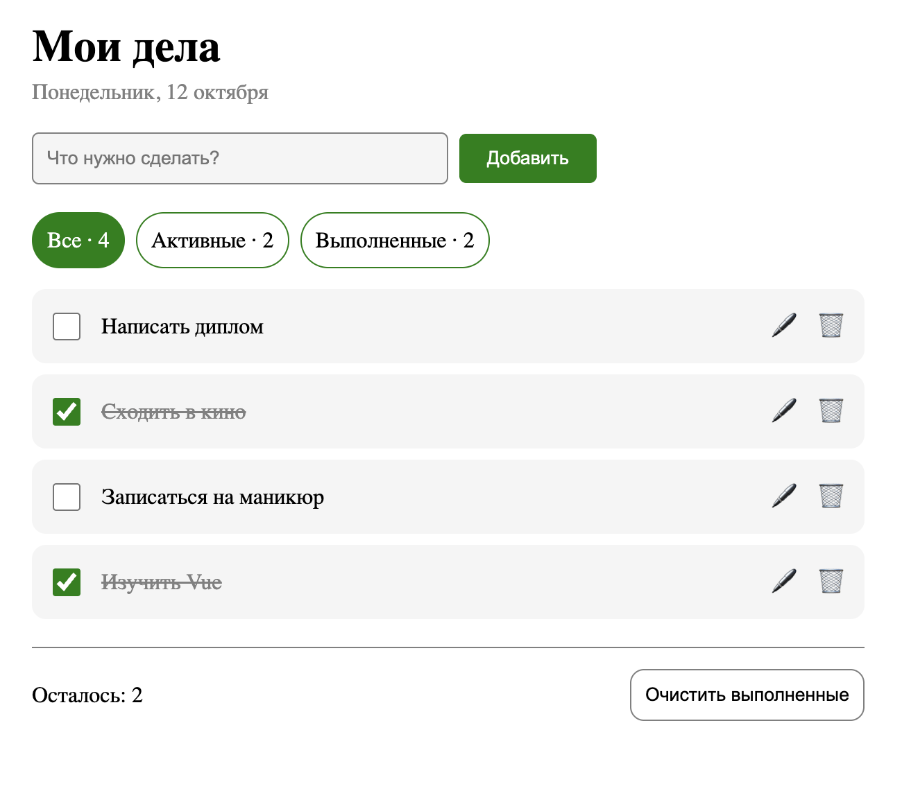

# Todo-лист с фильтрами и localStorage

Стек: Vue 3 (Composition API) + TypeScript + Vite

О приложении:
- Добавление, редактирование и удаление задач
- Фильтры Все / Активные / Выполненные со счетчиками
- Очистка выполненных
- Сохранение в localStorage

Построено на компонентах с props и emit, computed для фильтрации, composable useLocalStorage

### Запуск проекта:

```sh
npm i
npm run dev
```

### Как оно выглядит:

